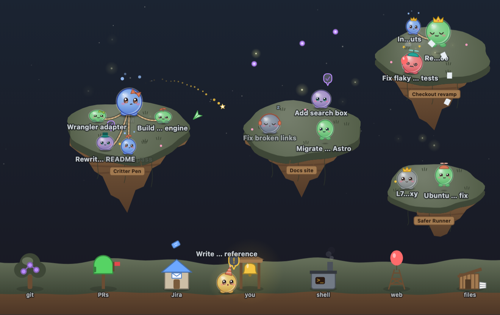

# Critter Pen

An [Agent Wrangler](https://github.com/portswigger-tim/agent-wrangler) extension that
shows every session as a small round critter living on floating islands. Each task is
an island. A critter's colour and antics are its session's status. When a session
does something, its critter throws something at the matching building on the
mainland: commit dots at the git tree, a paper plane at the PR mailbox, a ticket at
the Jira post office.



## What you'll see

| Critter | Session |
| --- | --- |
| Green, hopping | Working: running tools, a background job (the board's **JOB**), or a running sub-agent or agent-team member |
| Blue, bobbing with "…" | Thinking: working but quiet for a while, or idle while a session it spawned or nests is still working |
| Amber, "!", at the bell | Needs you: a permission prompt, a question or an API error |
| Red, dizzy, smoking | One of its own PRs has failing checks |
| Lilac, sitting, with a ✓ | Finished a turn you haven't looked at yet. Clicking the critter or opening the session on the board clears it. Remembered per browser, and it never dozes off |
| Grey, awake and relaxed | Idle at its prompt |
| Grey, dozing, "z z z" | No live terminal (the board's **RESUME**), snoozed, or quiet for 30+ min |
| Waves and walks off | Archived |

- **Islands:** sessions without a task share a small rocky islet.
- **Personality:** now and then a critter yawns, stretches, looks around, hums or
  chats with an islandmate. Eyes follow your cursor when it's close, siblings wave
  at a newly spawned critter, and a finished critter does a happy wiggle. Each
  critter's quirks are seeded from its session id, so they never fall into step.
- **Leashes:** a dotted leash joins a session to the sessions it spawned.
- **Names:** each critter's name sits under it. When critters crowd together, the
  names never overlap: the critters that need you keep theirs in place, others shift
  aside or above their heads, and a name with no room left fades to a whisper. Critters
  waiting at the bell show their name above their heads. Hover a critter for its full
  name.
- **Click:** clicking a critter opens its session on the board.
- **Reduced motion:** the pen follows your OS reduced-motion setting live, swapping
  motion for colour and opacity changes. Personality and ambient fireflies or petals
  switch off, and glances become instant.
- **Themes:** colours come from the board theme, so every Agent Wrangler theme works.

Critter Pen deliberately shows no "needs you" counts or badges.

## Install

In Agent Wrangler, open **Settings → Extensions → + Add extension → Git URL** and paste:

```
https://github.com/portswigger-tim/agent-wrangler-critterpen
```

Review the requested capabilities, approve, and **Critters** appears on the rail:

- `sessions:read`: the board's sessions, to draw the critters.
- `board:broadcast`: tool activity sent to the browser (see below).

It has no dependencies and needs no build step.

## Where the activity comes from

Statuses, PR and Jira links, and spawn lineage come from the board graph. Per-tool
activity (git, shell, file edits, web) isn't in the graph, so a server-side sweep
tails each live Claude session's transcript and classifies its tool calls. Labels are
only ever chosen from a fixed vocabulary, such as `git push`, `#482` or `PROJ-123`.
Command text, file paths, URLs and tool output never leave the server. Sessions it
can't attribute with certainty, such as two sessions sharing one working directory,
are skipped. Codex sessions show status but not tool activity for now. Details are in
[docs/activity-feed.md](docs/activity-feed.md).

## Repository layout

| Path | What |
| --- | --- |
| `package.json`, `index.js` | Extension declaration and manifest (`critter-pen`): the Critters `view` and the activity sweep |
| `public/index.js` | Browser entry: feeds each board graph through the adapter into the renderer |
| `public/adapter/` | Pure graph → `PenState` / `PenEvent[]` mapping (runs in the browser and under `node --test`) |
| `public/engine/` | The Canvas renderer (`pen.js`, `scene.js`, `art.js`, …), with no Agent Wrangler dependency, plus a standalone demo |
| `server/` | The activity sweep: transcript tool use → classified events, broadcast to the browser |
| `DESIGN.md` | Product brief, visual language, and the adapter ↔ engine contract |

## Development

### Engine demo (no Agent Wrangler needed)

```bash
cd public/engine && python3 -m http.server
# open http://localhost:8000/demo.html
```

Fake sessions, buttons to force every status and event, and a light/dark toggle.

### Against a real board

Develop against an **isolated** wrangler, never your real `~/.agent-wrangler`.

```bash
# 1. Copy the extension into a scratch data dir (the script refuses ~/.agent-wrangler).
export AW_DATA_DIR=/tmp/aw-critters
scripts/dev-install.sh

# 2. From your agent-wrangler checkout, start a second wrangler on that data dir
#    and its own port.
cd ../agent-wrangler
AW_DEV=1 AW_DATA_DIR=/tmp/aw-critters AW_PORT=7991 node server/index.js
```

Open <http://localhost:7991> and dispatch a session or two to see critters. Sessions
on your main board don't show up there. Hand-placed extensions load at boot, so after
changing code, run `scripts/dev-install.sh` again and restart the dev wrangler.

### Tests

```bash
npm test                          # everything: adapter, contract, classifier, sweep, engine
cd public/engine && npm test      # engine only
```
