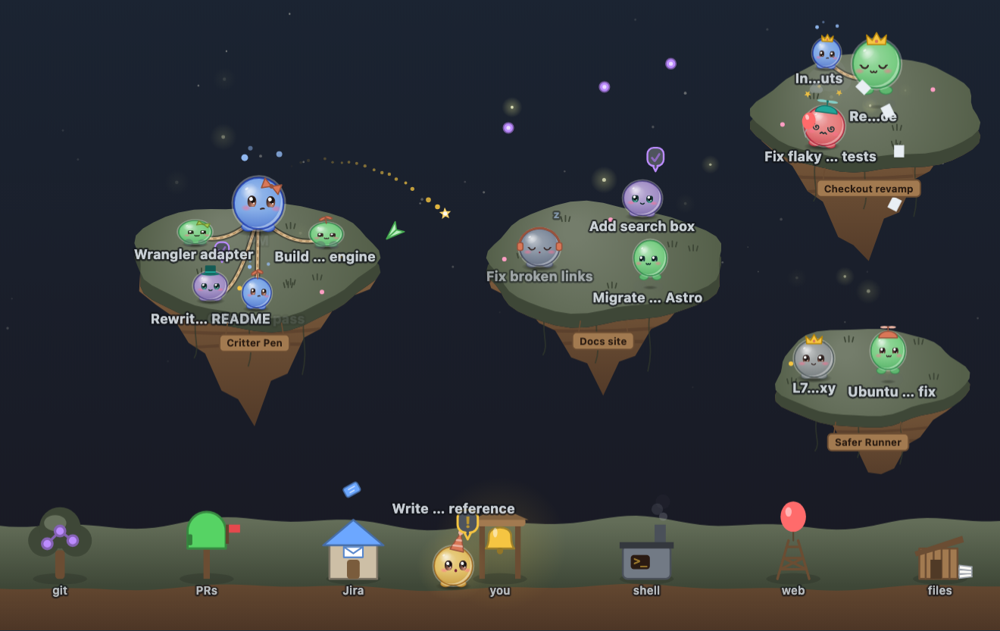

# Critter Pen engine

Framework-free Canvas 2D renderer that shows agent sessions as small round
creatures. It knows nothing about Agent Wrangler: feed it a `PenState` snapshot
and `PenEvent`s (see [`contract.js`](./contract.js) and `DESIGN.md`).



```js
import { createPen } from './pen.js';

const pen = createPen(el, {
  theme: 'auto',            // reads --green/--blue/--yellow/--red/--surface-2/--fg/--bg/--accent from el
  reducedMotion: undefined, // initial mode; default follows prefers-reduced-motion,
                            // and later OS changes always apply (no need to pass a snapshot)
  onCritterClick: (id) => {},  // optional; el also dispatches a bubbling 'critter-click' CustomEvent
});
pen.setState({ critters: [...] }); // call every tick; cheap and idempotent when nothing changed
pen.emit({ critterId, kind: 'pr', label: '#482' });
pen.resize();   // automatic via ResizeObserver; exposed for completeness
pen.destroy();
```

`el` must have a size; the canvas fills it. Below 170px tall the pen switches to
a compact tray layout with landmarks in a strip on the right.

## Demo

```sh
cd public/engine && python3 -m http.server 8080   # or: npx serve public/engine
open http://localhost:8080/demo.html               # ?theme=light  ?play=0
```

## Tests

```sh
cd public/engine && npm test   # node --test, no dependencies
```

## Files

| File | What |
| --- | --- |
| `contract.js` | Typedefs + validators shared with the adapter |
| `pen.js` | `createPen`: state diffing → sprites, rAF loop, poses, rendering, input |
| `art.js` | Vector drawing: critters (eyes, lids, mouths), accessories, bubbles, projectiles |
| `behaviour.js` | Personality: rare, seeded, deterministic idle behaviours and pose modifiers |
| `ambient.js` | Sky, fireflies (dark) and petals/motes (light); stateless |
| `scene.js` | Islands, signposts, mainland and building landmarks |
| `layout.js` | Pure layout: islands, mainland, critter placement |
| `wander.js` | Island wandering and bell queueing |
| `diff.js` | Pure snapshot diff |
| `color.js` | Colour parsing/mixing, HSL, pastel status colours, theme token reading |
| `util.js` | Hashing, seeded RNG, easing, springs, text truncation |

`sheet.html` is a character sheet: every status face and personality behaviour
drawn large (`?theme=light`, `?t=3` to freeze time, `?r=60` for size). Use it
when changing the art.

Everything lives in `public/engine/` because the wrangler only serves an
extension's `public/` folder; keep imports relative and inside this directory.
